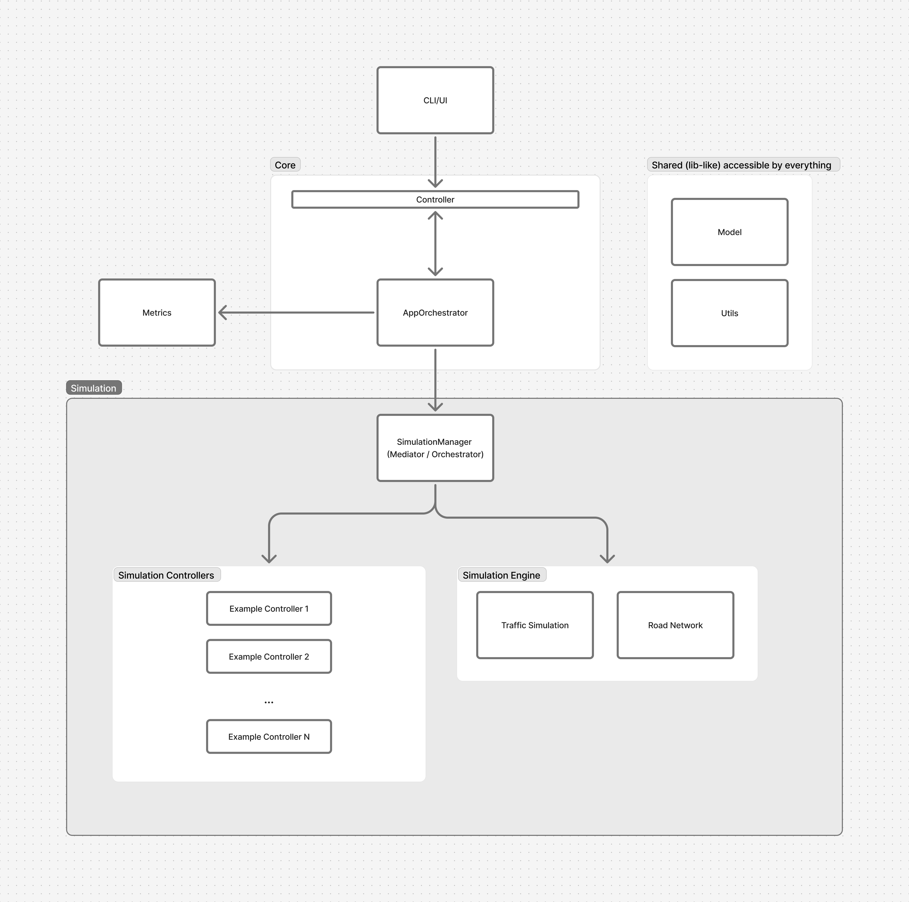

# TrafficVillage

Village-scale traffic light simulation for comparing control algorithms.
University team project — simulation software, not a real-world deployable system.

## Prerequisites

- [.NET 10 SDK](https://dotnet.microsoft.com/download/dotnet/10.0)

## Quick start

```bash
# Build
dotnet build

# Run tests
dotnet test

# Run simulation
dotnet run --project src/TrafficVillage
```

## Project structure

The solution compiles into a single executable application (`TrafficVillage`) and a single test project (`TrafficVillage.Tests`):

| Module / Directory | Owner | Description |
|--------------------|-------|-------------|
| `src/TrafficVillage/Cli` | Marek | Application entry point (`Program.cs`) |
| `src/TrafficVillage/Core` | Marek | `AppOrchestrator` composition root |
| `src/TrafficVillage/Model` | Szymon & Kądź | Shared types, domain records, and interfaces |
| `src/TrafficVillage/Utils` | Szymon & Kądź | Helpers and guards |
| `src/TrafficVillage/Metrics` | Marek | Metrics collectors and telemetry |
| `src/TrafficVillage/Simulation` | Michał | `SimulationManager` orchestration |
| `src/TrafficVillage/Simulation/Controllers` | Bartek | Traffic light controllers (e.g. `NoOpController`) |
| `src/TrafficVillage/Simulation/Engine/RoadNetwork` | Eryk | Graph representation and map loading |
| `src/TrafficVillage/Simulation/Engine/Traffic` | Michał | Vehicle dynamics and traffic simulation |
| `tests/TrafficVillage.Tests` | Team | Consolidated unit and integration test suite |

See [docs/api-contracts.md](docs/api-contracts.md) for interface definitions.
See [docs/architecture.md](docs/architecture.md) for design overview.



## Git workflow

1. **Never push directly to `main`**
2. Create a feature branch: `feature/<short-description>`
3. Open a Pull Request
4. Get **1 approval** from a teammate (not the PR author)
5. CI must pass before merge

## Resources

- `resources/maps/` — JSON map files (e.g. `single_intersection.json`, `village_01.json`)
- `resources/demand/` — YAML demand scenarios (e.g. `morning_rush.yaml`)

## CI

GitHub Actions runs `dotnet build` and `dotnet test` on every push and PR to `main` using .NET 10.
